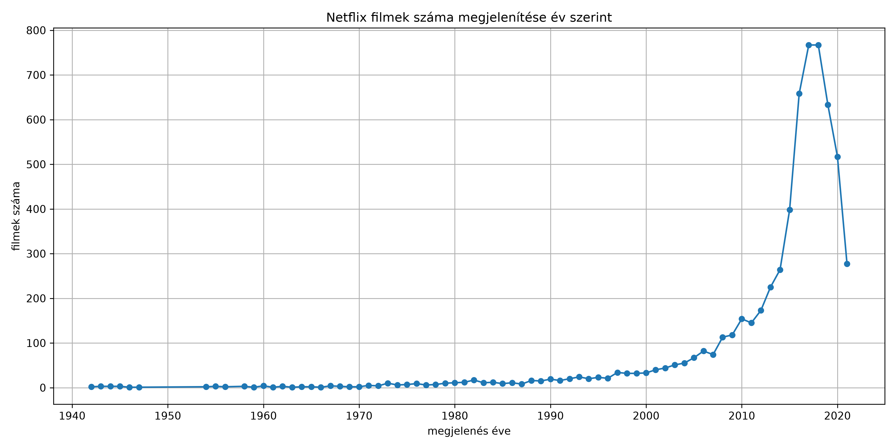
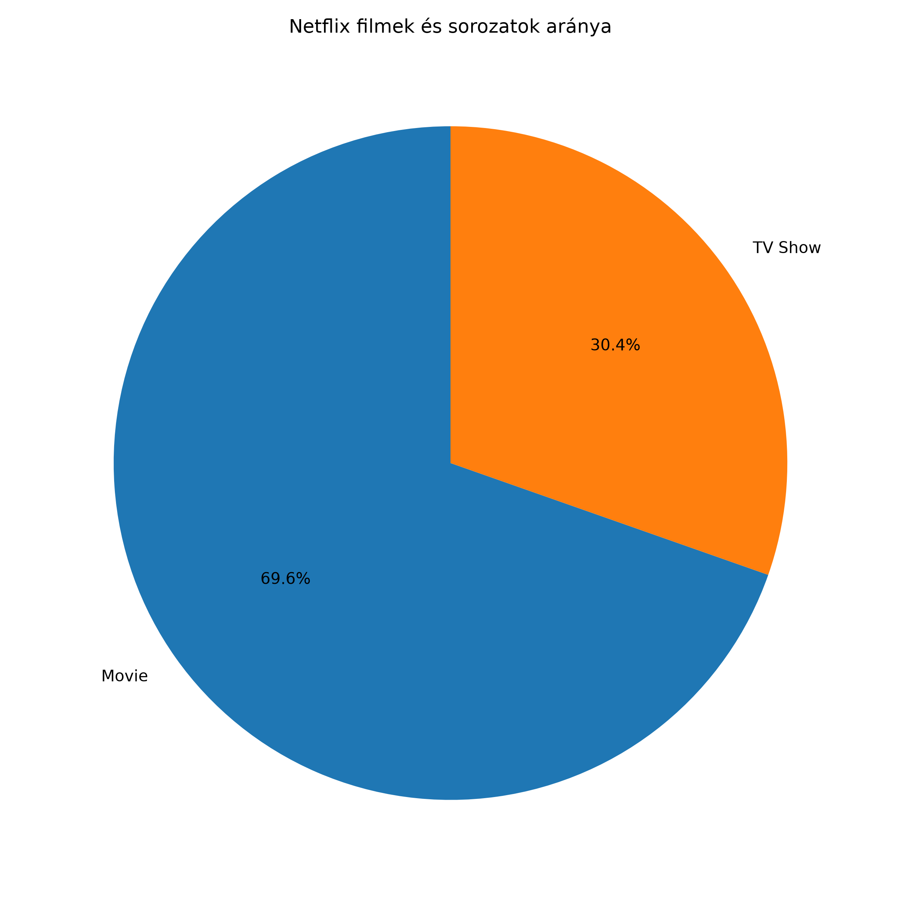

# Netflix adatelemzési projekt

## 1. A projekt bemutatása

A beadandó célja egy Kaggle-ről letöltött Netflix-adatbázis feldolgozása és elemzése Python programozási nyelv segítségével.

A projekt során öt különböző kérdésre kerestünk választ. Az adatok feldolgozásához a **Pandas**, a statisztikai számításokhoz a **NumPy**, az eredmények grafikus megjelenítéséhez pedig a **Matplotlib** könyvtárat használtuk.

## 2. Felhasznált adatbázis

**Adatbázis neve:** Netflix Movies and TV Shows

**Forrás:** https://www.kaggle.com/datasets/shivamb/netflix-shows

A `netflix_titles.csv` fájl a Netflix kínálatában szereplő filmek és sorozatok adatait tartalmazza.

Az adatbázis többek között a következő információkat tartalmazza:

- Film vagy sorozat címe
- Tartalom típusa
- Ország
- Megjelenési év
- Korhatár-besorolás
- Játékidő

## 3. Adatelemzési feladatok

### 3.1. A 10 leggyakoribb ország

Az első feladatban azt vizsgáltuk, hogy melyik tíz ország szerepel a legtöbbször a Netflix-adatbázisban.

A `country` oszlopból eltávolítottuk a hiányzó értékeket, majd a több országot tartalmazó cellákat külön elemekre bontottuk.

A Pandas `value_counts()` függvényével megszámoltuk az országok előfordulását, a `head(10)` segítségével pedig kiválasztottuk a tíz leggyakoribbat.

### 3.2. Az 5 leggyakoribb korhatár-besorolás

A második feladatban a filmek és sorozatok korhatár-besorolását vizsgáltuk.

A `rating` oszlop adatait feldolgoztuk, kiszűrtük az érvényes besorolásokat, majd meghatároztuk az öt leggyakoribb kategóriát.

Ehhez a Pandas `isin()`, `value_counts()` és `head()` függvényeit használtuk.

### 3.3. Filmek átlagos játékideje és szórása

A harmadik feladatban a filmek játékidejét elemeztük.

Először kiszűrtük a `Movie` típusú tartalmakat, majd a `duration` oszlopból kinyertük a játékidőket percben.

A hiányzó értékek eltávolítása után a NumPy segítségével kiszámítottuk:

- **Átlagos játékidő:** `np.mean()`
- **Játékidő szórása:** `np.std()`

Az átlag megmutatja a filmek jellemző hosszát, a szórás pedig azt, hogy a játékidők mennyire térnek el az átlagtól.

### 3.4. Filmek száma megjelenési évenként

A negyedik feladatban azt vizsgáltuk, hogyan változott a Netflix-adatbázisban szereplő filmek száma a megjelenési évek szerint.

A Pandas `groupby()` függvényével megjelenési év szerint csoportosítottuk a filmeket, majd a `size()` segítségével megszámoltuk az egyes évekhez tartozó tartalmakat.

Az eredményeket Matplotlib segítségével vonaldiagramon ábrázoltuk.



A diagram szemlélteti, hogyan változik az adatbázisban szereplő filmek száma a megjelenési év függvényében.

### 3.5. Filmek és sorozatok aránya

Az ötödik feladatban megvizsgáltuk, hogy a Netflix-adatbázisban milyen arányban szerepelnek filmek és sorozatok.

A `type` oszlopban található értékeket a Pandas `value_counts()` függvényével számoltuk meg.

Az eredményeket Matplotlib segítségével kördiagramon jelenítettük meg.



A kördiagram százalékos formában mutatja a filmek és sorozatok megoszlását.

## 4. Felhasznált technológiák

| Technológia | Felhasználás |
|---|---|
| Python | A program elkészítése |
| Pandas | Adatok beolvasása, szűrése és csoportosítása |
| NumPy | Átlag és szórás számítása |
| Matplotlib | Grafikonok készítése |
| Git és GitHub | Verziókezelés és a projekt közzététele |

## 5. A program futtatása

A program futtatásához Python telepítése szükséges.

A felhasznált könyvtárak telepítése:

```bash
python -m pip install pandas numpy matplotlib
```

A program indítása:

```bash
python beadando.py
```

A `netflix_titles.csv` fájlnak a Python-program által használt elérési útvonalon kell lennie.

## 6. A projekt fájljai

| Fájlnév | Leírás |
|---|---|
| `beadando.py` | Az adatelemzést végző Python-program |
| `netflix_titles.csv` | A Kaggle-ről letöltött adatbázis |
| `netflix_film_megjelenes_ev_szerint.png` | A filmek számát ábrázoló vonaldiagram |
| `netflix_film_sorozat_aranya.png` | A filmek és sorozatok arányát bemutató kördiagram |
| `README.md` | A projekt dokumentációja |

## 7. Összegzés

A beadandó során egy valós adathalmaz feldolgozásán keresztül gyakoroltuk a Python adatelemzéshez használható könyvtárait.

A Pandas segítségével megtanultuk az adatok szűrését, csoportosítását és rendezését. A NumPy alkalmazásával statisztikai számításokat végeztünk, a Matplotlib könyvtárral pedig az eredményeket grafikus formában jelenítettük meg.

A projekt során szerzett tapasztalatok más adatelemzési feladatoknál is felhasználhatók.
